<div align="center">


**↑ Real output of this skill — rendered headlessly from [`assets/templates/threejs-starter.html`](assets/templates/threejs-starter.html), zero manual touch-ups.**

# 🎬 Pro 3D Animator — AI Agent Skill

**Turn any AI agent into a professional 3D artist & animator — Three.js + Blender, 8 art styles, film-grade animation, sound design.**

[](LICENSE)
[](SKILL.md)
[](#-two-production-pipelines)
[](#-8-production-ready-art-styles)
[](#-install-30-seconds)

</div>

---

## What is this?

**Pro 3D Animator** is a complete [Agent Skill](SKILL.md) — a structured knowledge package (`SKILL.md` + reference documents + code templates) that any LLM agent (Claude Code, Claude Desktop, ChatGPT, Gemini, Cursor, Copilot, OpenCode, or your own agent harness) can read to start producing **professional-grade 3D work** instead of the typical "gray cube with linear easing" AI output.

It encodes the full studio process: client intake → art direction → storyboarding → scene building → **animation with the 12 principles** → **sound design** → QA gate → delivery.

### What your agent can do after installing

- 🎨 Build **advanced 3D models & scenes** in Three.js or Blender — procedural characters, environments, dioramas, product shots
- 🏀 Animate like a **human professional animator**: anticipation, squash & stretch with volume preservation, overlapping action, settle overshoot, arcs, secondary motion — with a full easing library (JS + Blender keyframe recipes)
- 🎥 Control the **camera** like a cinematographer: push-ins, orbits, follow rigs, shot grammar, lens choice, DOF
- 🎛 Pick and enforce one of **8 complete art styles** (palettes, materials, lighting rigs, motion personalities)
- 🔊 Add **professional sound design**: synthesized SFX (Web Audio / ffmpeg), per-style sound palettes, frame-accurate sync, mixing targets
- 📦 Deliver **exact specs**: the right duration in frames, the right resolution/fps, MP4/WebM/GIF or a live web scene — verified with a QA checklist
- ❓ Ask the user **exactly the right questions first** (subject, duration, resolution, style, sound, output) like a real studio

## 📥 Install (30 seconds)

**Claude Code / Claude Desktop:**
```bash
git clone https://github.com/matinsizen/ai-3d-animator-skill.git ~/.claude/skills/pro-3d-animator
# → say: "Make me a 3D animation of a rocket launching, 10 seconds, puffy style"
```

**Any other agent:** copy the repo folder into your agent's workspace and tell it:

> Read `SKILL.md` and follow it. Task: *"…your 3D/animation request…"*

No dependencies to run the skill itself. Per pipeline: **Path A** needs any modern browser (Node + Playwright optional for headless video); **Path B** needs [Blender](https://www.blender.org/) 3.6+.

## 🧭 How it works

```mermaid
flowchart LR
  A["Phase 0 · INTAKE<br/>subject · duration · resolution<br/>fps · style · sound · output"] --> B["Phase 1 · ART DIRECTION<br/>one of 8 style bibles"]
  B --> C["Phase 2 · STORYBOARD<br/>timing sheet: every action<br/>gets frames + a sound cue"]
  C --> D{"Phase 3 · BUILD"}
  D -- "interactive / web / loops" --> E["Path A · Three.js"]
  D -- "photoreal / physics / MP4" --> F["Path B · Blender headless"]
  E --> G["Phase 4 · ANIMATE<br/>12 principles + easing library<br/>anticipation → squash → settle"]
  F --> G
  G --> H["Phase 5 · SOUND<br/>Web Audio / ffmpeg synthesis<br/>sync ±2 frames"]
  H --> I["Phase 6 · QA GATE"] --> J["Phase 7 · DELIVER<br/>MP4 · WebM · GIF · live scene"]
```



## 🔀 Two production pipelines

| | **Path A — Three.js** | **Path B — Blender** |
|---|---|---|
| Best for | Interactive web scenes, loops, motion graphics, fast iteration | Photorealism, physics sims, cloth, particles, video files |
| Output | Live web page · WebM · headless MP4/GIF | MP4 (Cycles/EEVEE), PNG stills |
| Template | [`threejs-starter.html`](assets/templates/threejs-starter.html) — runs on open | [`blender-starter.py`](assets/templates/blender-starter.py) — `blender -b -P …` |
| Docs | [`references/pipeline-threejs.md`](references/pipeline-threejs.md) | [`references/pipeline-blender.md`](references/pipeline-blender.md) |

Both templates are **working demos you can run right now** and production starters with every rule of the skill pre-wired.

## 🎨 8 production-ready art styles

Full bibles in [`references/art-styles.md`](references/art-styles.md): palette, geometry rules, exact material values (Three.js **and** Blender), lighting rig, motion personality, sound personality, do/don't.

| Style | Identity | Palette |
|---|---|---|
| **Puffy / Bubbly** | soft-inflatable, zero sharp edges, squashy |     |
| **Claymation** | matte clay, stop-motion stepped 12 fps |     |
| **Low-poly Flat** | faceted, flat-shaded, bold palette |     |
| **Voxel** | grid-locked cubes, toy-like |     |
| **Isometric Diorama** | orthographic 45° tiny world |     |
| **Neon / Cyberpunk** | dark + emissive + bloom, wet floor |     |
| **Cel / Anime** | toon bands, ink outline, smears |    |
| **Frosted Glass** | transmission glass, studio light |    |

## ✨ What "professional animation" means here

The skill's [animation reference](references/animation-principles.md) turns the 12 principles into **copy-paste recipes with exact frame counts**:

- **Timing charts** — blink 3f · hop anticipation 4–6f · rise 6–8f (ease-out) · fall 5–6f (ease-in) · land squash 2–3f · settle 6–8f
- **Easing library** — 8 eases with JS implementations *and* Blender keyframe/handle equivalents, each with a "when to use" rule (linear only for turntables!)
- **Volume-preserving squash** — `scale.y = s ⇒ scale.xz = 1/√s`, origin at the contact point
- **The trio on every action** — anticipation → action → settle-overshoot
- **Overlap offsets** — body f0 · head +2f · arms +4f · tail +6f
- **Loop-safe engine** — all ambient motion uses sines whose period divides the loop length: seams become invisible
- **Camera language** — push-in/orbit/follow/whip recipes, shot sizes, lens table, DOF
- **Anti-pattern audit** — 11 checks that catch "AI-looking" motion before delivery

## 🔊 Sound design, from pure code

[`references/sound-design.md`](references/sound-design.md) ships a **synthesized SFX kit** — pop, thud, whoosh, boing, pluck, sparkle, blip — as ready Web Audio code (Path A) and ffmpeg `lavfi` recipes (Path B), plus per-style sound palettes, mixing targets (−3 dBFS peaks, −16 LUFS), cue scheduling with ±2-frame sync, and one-pass **video+audio recording** via `MediaRecorder`.

## 🖥 Run the demo

```bash
git clone https://github.com/matinsizen/ai-3d-animator-skill.git
# Path A demo — open in a browser:
open ai-3d-animator-skill/assets/templates/threejs-starter.html
# Path B demo — renders a full animated MP4 headlessly:
blender -b -P ai-3d-animator-skill/assets/templates/blender-starter.py -- --res 1920x1080 --fps 30 --secs 8
```

The Three.js starter accepts render parameters:

| URL param | Effect |
|---|---|
| `?still=1&t=1.0` | deterministic single frame (headless rendering contract) |
| `?res=1080x1920` | output resolution (vertical, square, 4K…) |
| `?loop=6` | loop length in seconds |
| `?speed=1.5` | playback speed |

Headless video pipeline (used to make the GIF at the top of this README):

```bash
npm i -D playwright && npx playwright install chromium --with-deps
node examples/render-frames.mjs assets/templates/threejs-starter.html --w 1920 --h 1080 --fps 30 --secs 8
bash examples/assemble-video.sh frames scene.mp4 --gif preview.gif
```

## 📁 Repository map

```
ai-3d-animator-skill/
├── SKILL.md                        ← the skill (agent entry point)
├── references/
│   ├── intake.md                   ← exact questions + defaults matrix
│   ├── art-styles.md               ← 8 complete style bibles
│   ├── animation-principles.md     ← 12 principles, easing lib, camera language
│   ├── pipeline-threejs.md         ← Path A production pipeline
│   ├── pipeline-blender.md         ← Path B headless bpy pipeline
│   ├── sound-design.md             ← synth SFX kits + mixing rules
│   └── qa-checklist.md             ← the delivery gate
├── assets/templates/
│   ├── threejs-starter.html        ← runnable Path A demo + starter
│   └── blender-starter.py          ← runnable Path B demo + starter
├── examples/
│   ├── render-frames.mjs           ← headless deterministic frame capture
│   └── assemble-video.sh           ← ffmpeg MP4 + GIF assembly
└── docs/preview.gif · preview.png  ← real rendered output
```

## ❓ FAQ

**Which agents can use this?** Any agent that can read files — Claude Code / Claude Desktop (native skills), ChatGPT & Gemini (upload/paste `SKILL.md` + relevant references), Cursor/Copilot (add to rules/workspace), or custom harnesses (it's plain Markdown).

**Does it need Blender installed?** Only for Path B. Path A (Three.js) runs in a browser — including fully headless video export via Playwright.

**Can my agent ship real MP4s?** Yes — Path A captures deterministic frames and assembles with ffmpeg; Path B renders natively. Both add sound in the same pass.

**Why "Puffy" as the default style?** It's the highest charm-per-effort style and the hardest to make look cheap — perfect for proving the pipeline. All 8 styles get equal depth in the reference.

## 🤝 Contributing

PRs welcome — new style bibles, more easing utilities, additional templates (e.g., Unity/Godot paths), or demo scenes. Please keep SKILL.md under 500 lines (progressive disclosure) and put depth in `references/`.

## 📄 License

[MIT](LICENSE) — free for personal and commercial use. The demo scene, templates, and docs were generated with the skill itself.

<div align="center">
<sub><b>Keywords:</b> AI agent skill · 3D animation · Three.js · Blender · bpy · SKILL.md · procedural animation · squash and stretch · easing functions · motion graphics · sound design · Web Audio · ffmpeg · Claude skills · GPTs · AI video generation</sub>
</div>
