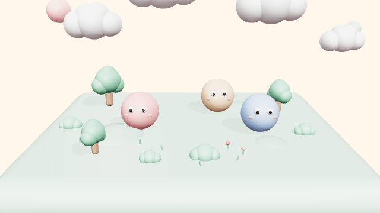
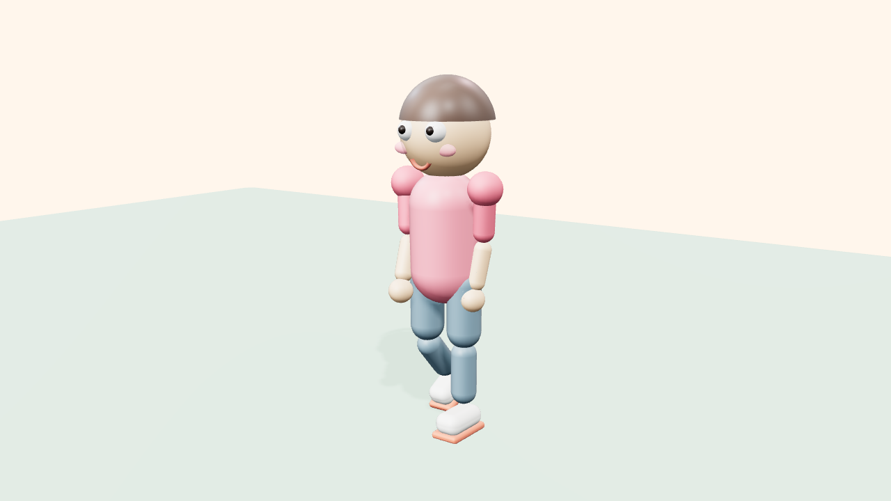
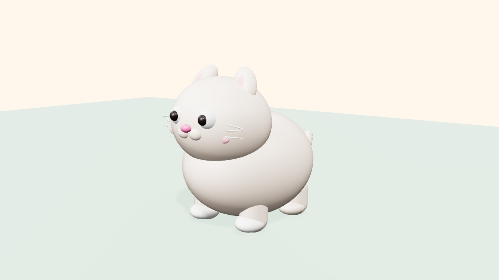
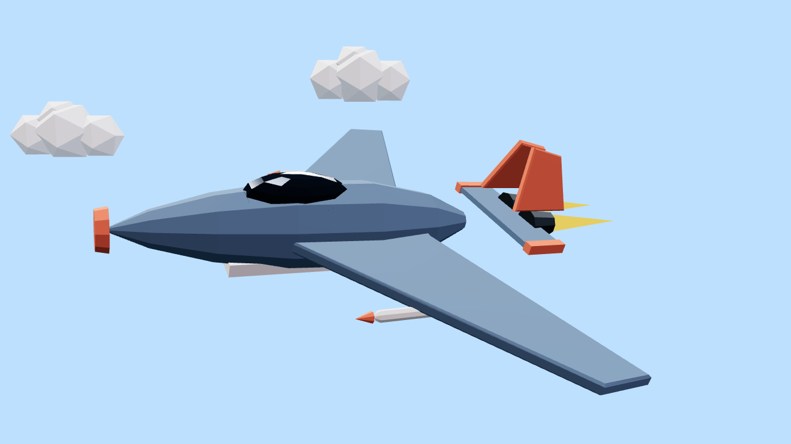
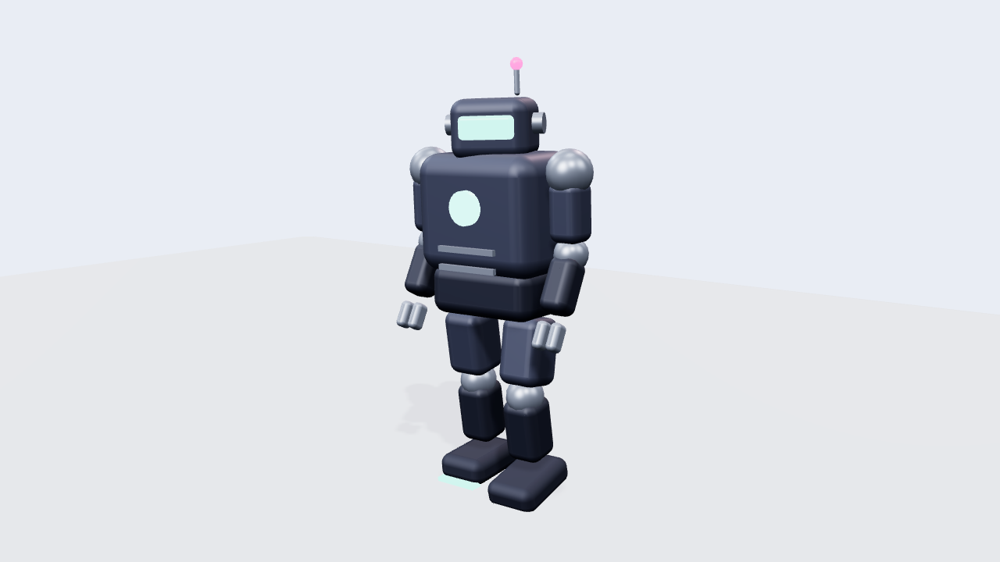
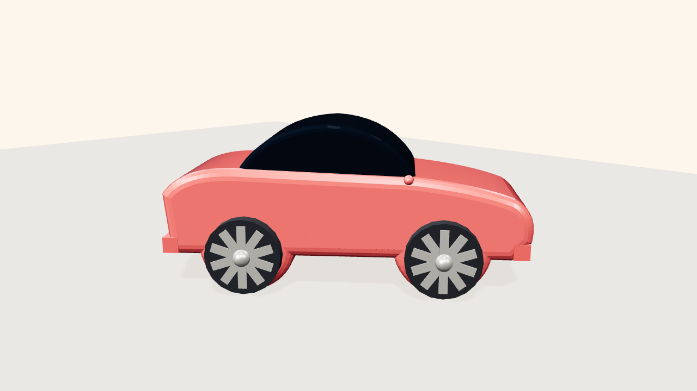
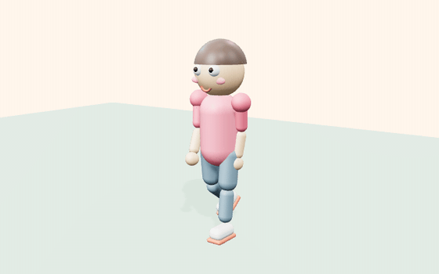
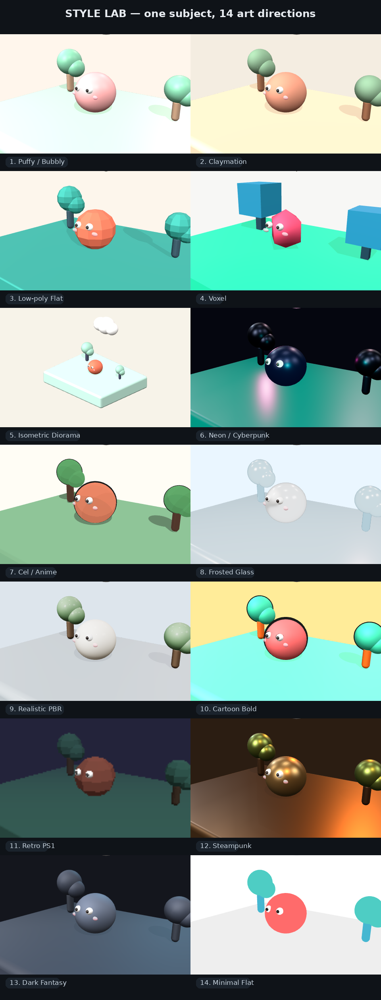

<div align="center">



**↑ Real output of this skill — rendered headlessly from [`assets/templates/threejs-starter.html`](assets/templates/threejs-starter.html), zero manual touch-ups.**

# 🎬 Pro 3D Animator — AI Agent Skill

**Turn any AI agent into a professional 3D artist & animator —**
**Three.js + Blender pipelines · 14 art styles · 5 rigged example models · film-grade animation · sound design**

[](LICENSE)
[](SKILL.md)
[](#-two-production-pipelines)
[](#-14-production-ready-art-styles)
[-E8639B)](#-example-model-library--live-demos)
[](https://matinsizen.github.io/ai-3d-animator-skill/)
[](#-install-30-seconds)

</div>

---

## What is this?

**Pro 3D Animator** is a complete [Agent Skill](SKILL.md) — a structured knowledge package (`SKILL.md` + 7 reference documents + 2 production templates + **a library of 5 fully-built example models**) that any LLM agent (Claude Code, Claude Desktop, ChatGPT, Gemini, Cursor, Copilot, OpenCode, or your own agent harness) can read to start producing **professional-grade 3D work** instead of the typical "gray cube with linear easing" AI output.

It encodes the full studio process: client intake → art direction (14 style bibles) → storyboarding → scene building → **animation with the 12 principles** → **sound design** → QA gate → delivery.

### What your agent can do after installing

- 🎨 Build **advanced 3D models & scenes** in Three.js or Blender — fully-rigged characters, vehicles, robots, environments, dioramas, product shots
- 🧍 Start from **real, working example models**: a rigged human (walk / idle / wave), a puffy cat, a jet fighter, a mech robot, a car — every one in *both* pipelines
- 🏀 Animate like a **human professional animator**: anticipation, squash & stretch with volume preservation, overlapping action, settle overshoot, arcs, secondary motion — with a full easing library (JS + Blender keyframe recipes)
- 🎥 Control the **camera** like a cinematographer: push-ins, orbits, chase rigs, shot grammar, lens choice, DOF
- 🎛 Pick and enforce one of **14 complete art styles** — palettes, geometry laws, exact material values, lighting rigs, motion personalities (including **Puffy/Bubbly: zero sharp edges anywhere**)
- 🔊 Add **professional sound design**: synthesized SFX (Web Audio / ffmpeg), per-style sound palettes, frame-accurate sync, mixing targets
- 📦 Deliver **exact specs**: the right duration in frames, the right resolution/fps, MP4/WebM/GIF or a live web scene — verified with a QA checklist
- ❓ Ask the user **exactly the right questions first** (subject, duration, resolution, style, sound, output) like a real studio

## 🌐 Live demos (GitHub Pages)

> **[▶ Open the demo gallery](https://matinsizen.github.io/ai-3d-animator-skill/)** — every example model runs interactively in your browser, plus the **Style Lab** showing one subject art-directed 14 different ways.

| | | |
|---|---|---|
| [🧍 Human](https://matinsizen.github.io/ai-3d-animator-skill/demos/human/) | [🐱 Cat](https://matinsizen.github.io/ai-3d-animator-skill/demos/cat/) | [✈️ Jet](https://matinsizen.github.io/ai-3d-animator-skill/demos/jet/) |
| [🤖 Robot](https://matinsizen.github.io/ai-3d-animator-skill/demos/robot/) | [🚗 Car](https://matinsizen.github.io/ai-3d-animator-skill/demos/car/) | [🎨 Style Lab](https://matinsizen.github.io/ai-3d-animator-skill/style-lab/) |

## 📐 Example model library — live previews

Every model is **procedural (no external assets)**, shipped as a Three.js ES module **and** a headless Blender script, with animations that are pure functions of time (seek anywhere, loop perfectly):

| Model | Preview | What it teaches |
|---|---|---|
| 🧍 **Milo** — stylized human |  | Full joint hierarchy (hips→knees→ankles, torso→shoulders→elbows), **walk cycle with knee bend & counter-rotation**, idle breathing, wave with overshoot — [`threejs-human.js`](examples/human-character/threejs-human.js) · [`blender-human.py`](examples/human-character/blender-human.py) |
| 🐱 **Mochi** — puffy cat |  | The **zero-sharp-edges law**: spheres only; volume-preserving squash & stretch; sine tail with per-segment overlap — [`threejs-cat.js`](examples/fluffy-cat/threejs-cat.js) · [`blender-cat.py`](examples/fluffy-cat/blender-cat.py) |
| ✈️ **Swift** — jet fighter |  | Lathe fuselage, extruded delta wings, canted twin tails, afterburner pulse, **banked patrol loop + chase camera** — [`threejs-jet.js`](examples/jet-fighter/threejs-jet.js) · [`blender-jet.py`](examples/jet-fighter/blender-jet.py) |
| 🤖 **Bolt** — toy mech |  | Rounded-box hard surface, **stomp walk with weight dips**, servo head scan, pulsing emissives — [`threejs-robot.js`](examples/robot-mech/threejs-robot.js) · [`blender-robot.py`](examples/robot-mech/blender-robot.py) |
| 🚗 **Jelly** — city car |  | Profile-extrude body with wheel arches, glass greenhouse, **spoked wheels that visibly spin**, showroom turntable & drive mode — [`threejs-car.js`](examples/sports-car/threejs-car.js) · [`blender-car.py`](examples/sports-car/blender-car.py) |

<details>
<summary><b>⭐ The walk cycle in motion</b> (rendered headlessly from the demo page)</summary>



</details>

And the **Style Lab** — the same blob character through all 14 art directions (proof that a style is a *system*: palette + geometry + material + light + motion):

<div align="center"></div>

## 📥 Install (30 seconds)

**Claude Code / Claude Desktop:**
```bash
git clone https://github.com/matinsizen/ai-3d-animator-skill.git ~/.claude/skills/pro-3d-animator
# → say: "Make me a 3D animation of a jet flying at sunset, 10 seconds, low-poly"
```

**Any other agent:** copy the repo folder into your agent's workspace and tell it:

> Read `SKILL.md` and follow it. Task: *"…your 3D/animation request…"*

No dependencies to run the skill itself. Per pipeline: **Path A** needs any modern browser (Node + Playwright optional for headless video); **Path B** needs [Blender](https://www.blender.org/) 3.6+.

## 🧭 How it works

```mermaid
flowchart LR
  A["Phase 0 · INTAKE<br/>subject · duration · resolution<br/>fps · style · sound · output"] --> B["Phase 1 · ART DIRECTION<br/>one of 14 style bibles"]
  B --> C["Phase 2 · STORYBOARD<br/>timing sheet: every action<br/>gets frames + a sound cue"]
  C --> C2["Start from an example model<br/>human · cat · jet · robot · car"]
  C2 --> D{"Phase 3 · BUILD"}
  D -- "interactive / web / loops" --> E["Path A · Three.js"]
  D -- "photoreal / physics / MP4" --> F["Path B · Blender headless"]
  E --> G["Phase 4 · ANIMATE<br/>12 principles + easing library<br/>anticipation → squash → settle"]
  F --> G
  G --> H["Phase 5 · SOUND<br/>Web Audio / ffmpeg synthesis<br/>sync ±2 frames"]
  H --> I["Phase 6 · QA GATE"] --> J["Phase 7 · DELIVER<br/>MP4 · WebM · GIF · live scene"]
```



## 🔀 Two production pipelines

| | **Path A — Three.js** | **Path B — Blender** |
|---|---|---|
| Best for | Interactive web scenes, loops, motion graphics, fast iteration | Photorealism, physics sims, cloth, particles, video files |
| Output | Live web page · WebM · headless MP4/GIF | MP4 (Cycles/EEVEE), PNG stills |
| Template | [`threejs-starter.html`](assets/templates/threejs-starter.html) — runs on open | [`blender-starter.py`](assets/templates/blender-starter.py) — `blender -b -P …` |
| Examples | `examples/*/threejs-*.js` | `examples/*/blender-*.py` |
| Docs | [`references/pipeline-threejs.md`](references/pipeline-threejs.md) | [`references/pipeline-blender.md`](references/pipeline-blender.md) |

Both templates are **working demos you can run right now** and production starters with every rule of the skill pre-wired.

## 🎨 14 production-ready art styles

Full bibles in [`references/art-styles.md`](references/art-styles.md): palette, geometry laws, exact material values (Three.js **and** Blender), lighting rig, motion personality, sound personality, do/don't — **plus a live [Style Lab](https://matinsizen.github.io/ai-3d-animator-skill/style-lab/) rendering all of them**.

| # | Style | Identity | Palette |
|---|---|---|---|
| 1 | **Puffy / Bubbly** | soft-inflatable, **zero sharp edges**, squashy |     |
| 2 | **Claymation** | matte clay, stop-motion stepped 12 fps |     |
| 3 | **Low-poly Flat** | faceted, flat-shaded, bold palette |     |
| 4 | **Voxel** | grid-locked cubes, toy-like |     |
| 5 | **Isometric Diorama** | orthographic 45° tiny world |     |
| 6 | **Neon / Cyberpunk** | dark + emissive + bloom, wet floor |     |
| 7 | **Cel / Anime** | toon bands, ink outline, smears |    |
| 8 | **Frosted Glass** | transmission glass, studio light |    |
| 9 | **Realistic PBR** | believable materials, film-grade light |     |
| 10 | **Cartoon Bold** | saturated primaries, ink outlines |     |
| 11 | **Retro PS1** | low-poly, fog, pixelated, vertex-lit |     |
| 12 | **Steampunk & Industrial** | brass, rivets, steam, warm workshop |     |
| 13 | **Dark Fantasy** | mist, stone, cold rim light, weight |     |
| 14 | **Minimal Flat** | unlit flat colors, Swiss composition |     |

## ✨ What "professional animation" means here

The skill's [animation reference](references/animation-principles.md) turns the 12 principles into **copy-paste recipes with exact frame counts**:

- **Timing charts** — blink 3f · hop anticipation 4–6f · rise 6–8f (ease-out) · fall 5–6f (ease-in) · land squash 2–3f · settle 6–8f
- **Easing library** — 8 eases with JS implementations *and* Blender keyframe/handle equivalents, each with a "when to use" rule (linear only for turntables!)
- **Volume-preserving squash** — `scale.y = s ⇒ scale.xz = 1/√s`, origin at the contact point
- **The trio on every action** — anticipation → action → settle-overshoot
- **Overlap offsets** — body f0 · head +2f · arms +4f · tail +6f
- **Loop-safe engine** — all ambient motion uses sines whose period divides the loop length: seams become invisible
- **Camera language** — push-in/orbit/follow/chase recipes, shot sizes, lens table, DOF
- **Anti-pattern audit** — 11 checks that catch "AI-looking" motion before delivery

## 🔊 Sound design, from pure code

[`references/sound-design.md`](references/sound-design.md) ships a **synthesized SFX kit** — pop, thud, whoosh, boing, pluck, sparkle, blip — as ready Web Audio code (Path A) and ffmpeg `lavfi` recipes (Path B), plus per-style sound palettes, mixing targets (−3 dBFS peaks, −16 LUFS), cue scheduling with ±2-frame sync, and one-pass **video+audio recording** via `MediaRecorder`.

## 🖥 Run the demos

```bash
git clone https://github.com/matinsizen/ai-3d-animator-skill.git
cd ai-3d-animator-skill

# Live in a browser (start a tiny server — the demos are ES modules):
python3 -m http.server 8000
# → open http://localhost:8000/docs/            (demo gallery)
# → open http://localhost:8000/docs/style-lab/  (14 styles, switchable)

# Path A headless video — e.g. the human walk cycle at 1080p:
npm i -D playwright && npx playwright install chromium --with-deps
node examples/render-frames.mjs http://localhost:8000/docs/demos/human/index.html --w 1920 --h 1080 --fps 30 --secs 8
bash examples/assemble-video.sh frames human-walk.mp4 --gif human.gif

# Path B headless video — same models, rendered by Blender:
blender -b -P examples/human-character/blender-human.py -- --mode walk --secs 8 --fps 30 --render
blender -b -P examples/jet-fighter/blender-jet.py      -- --secs 8 --fps 30 --render
blender -b -P examples/sports-car/blender-car.py       -- --mode drive --secs 8 --fps 30 --render
```

The Three.js demos accept render parameters:

| URL param | Effect |
|---|---|
| `?still=1&t=1.0` | deterministic single frame (headless rendering contract) |
| `?res=1080x1920` | output resolution (vertical, square, 4K…) |
| `?loop=6` | loop length in seconds |
| `?speed=1.5` | playback speed |
| `?mode=wave` | pick an animation mode (`human`: walk/idle/wave, `robot`: patrol/idle, …) |

## 📁 Repository map

```
ai-3d-animator-skill/
├── SKILL.md                          ← the skill (agent entry point)
├── references/
│   ├── intake.md                     ← exact questions + defaults matrix
│   ├── art-styles.md                 ← 14 complete style bibles
│   ├── animation-principles.md       ← 12 principles, easing lib, camera language
│   ├── pipeline-threejs.md           ← Path A production pipeline
│   ├── pipeline-blender.md           ← Path B headless bpy pipeline
│   ├── sound-design.md               ← synth SFX kits + mixing rules
│   └── qa-checklist.md               ← the delivery gate
├── assets/templates/
│   ├── threejs-starter.html          ← runnable Path A demo + starter
│   └── blender-starter.py            ← runnable Path B demo + starter
├── examples/                         ← 📐 the example model library
│   ├── human-character/              ← rigged human: threejs + blender + docs
│   ├── fluffy-cat/                   ← puffy cat (zero sharp edges)
│   ├── jet-fighter/                  ← low-poly jet with chase cam
│   ├── robot-mech/                   ← rounded-box mech with weight walk
│   ├── sports-car/                   ← extruded-body car, 2 drive modes
│   ├── render-frames.mjs             ← headless deterministic frame capture
│   └── assemble-video.sh             ← ffmpeg MP4 + GIF assembly
├── docs/                             ← 🌐 GitHub Pages: live demos
│   ├── index.html                    ← demo gallery
│   ├── demos/{human,cat,jet,robot,car}/
│   ├── models/                       ← generated copies of the example modules (Pages serves /docs only)
│   ├── style-lab/index.html          ← one subject × 14 styles, switchable
│   └── preview-*.png · style-matrix.png · human-walk.gif
└── scripts/                          ← repo maintenance (demo generator, screenshots)
```

## ❓ FAQ

**Which agents can use this?** Any agent that can read files — Claude Code / Claude Desktop (native skills), ChatGPT & Gemini (upload/paste `SKILL.md` + relevant references), Cursor/Copilot (add to rules/workspace), or custom harnesses (it's plain Markdown).

**Does it need Blender installed?** Only for Path B. Path A (Three.js) runs in a browser — including fully headless video export via Playwright. Both paths ship the same 5 example models.

**Can my agent ship real MP4s?** Yes — Path A captures deterministic frames and assembles with ffmpeg; Path B renders natively. Both add sound in the same pass.

**Only cute styles?** No — 14 bibles span cute (Puffy, Cartoon) to grim (Dark Fantasy, Retro PS1) to photoreal (Realistic PBR, Frosted Glass). See the [Style Lab](https://matinsizen.github.io/ai-3d-animator-skill/style-lab/).

**Where do the preview images come from?** Every image in this README is real output rendered headlessly from the code in this repo — nothing is mocked up. `scripts/screenshot.mjs` regenerates them.

## 🤝 Contributing

PRs welcome — new style bibles, more example models (dragon? spaceship? city block?), additional templates (e.g., Unity/Godot paths), or demo scenes. Please keep SKILL.md under 500 lines (progressive disclosure) and put depth in `references/` and `examples/`.

## 📄 License

[MIT](LICENSE) — free for personal and commercial use. The demo scene, templates, example models, and docs were generated with the skill itself.

<div align="center">
<sub><b>Keywords:</b> AI agent skill · SKILL.md · 3D animation · Three.js · WebGL · Blender · bpy · procedural modeling · rigged character · walk cycle · 3D model generator · low-poly · voxel · isometric · cyberpunk · cel shading · toon shader · squash and stretch · easing functions · motion graphics · sound design · Web Audio · ffmpeg · Claude skills · GPTs · Cursor · AI video generation · procedural generation</sub>
</div>
