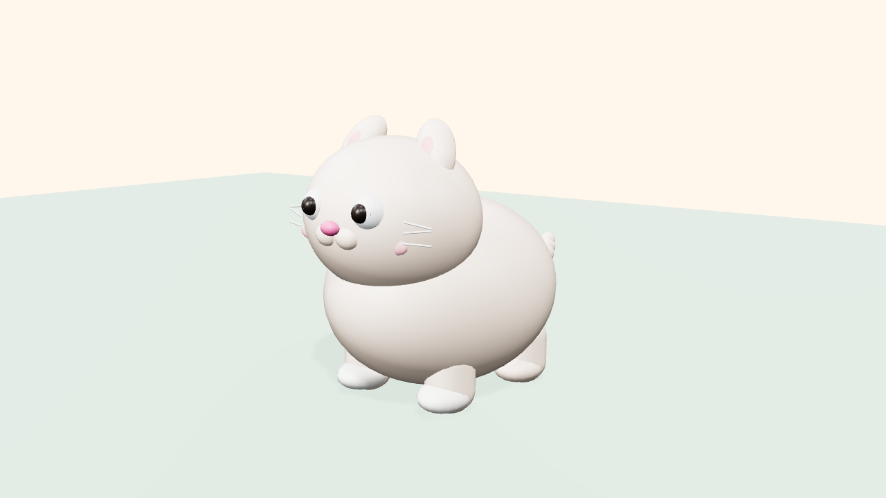

# Mochi — Puffy Cat

The **Puffy / Bubbly** style bible at its purest: a cat made only of spheres
and capsules — if an edge could cut foam, it doesn't exist. The skill's
signature animation trio (anticipation → squash & stretch → settle) on full
display.



## What it demonstrates

| Rule | Where |
|---|---|
| Zero-sharp-edges geometry law | spheres + capsules only, even the whiskers |
| Volume-preserving squash (`scale.y = s ⇒ scale.xz = 1/√s`) | `squash()` — origin at the ground contact point |
| Anticipation → flight stretch → impact squash → settle overshoot | `animateCat(rig, t, { mode: 'hop' })` |
| Overlapping action (tail lags the body, tip lags most) | 6-segment sine tail with per-segment phase offset |
| Secondary life: breathing, blinking, ear twitches | always-on layers, loop-safe sines |

## Run it

**Live demo:** `docs/demos/hunter…` → [`docs/demos/cat/`](https://matinsizen.github.io/ai-3d-animator-skill/demos/cat/) — modes `hop / loaf`.

**Blender (Path B):**
```bash
blender -b -P examples/fluffy-cat/blender-cat.py -- --secs 8 --fps 30 --render
```

## Customization knobs

- `C` palette — pastels from the Puffy bible or your brand colors
- Hop height/width: the `phases` table (`blender-cat.py`) or the `y` parabola (`threejs-cat.js`)
- Tail lag: the `0.85 rad` per-segment phase offset — increase for a floofier tail
