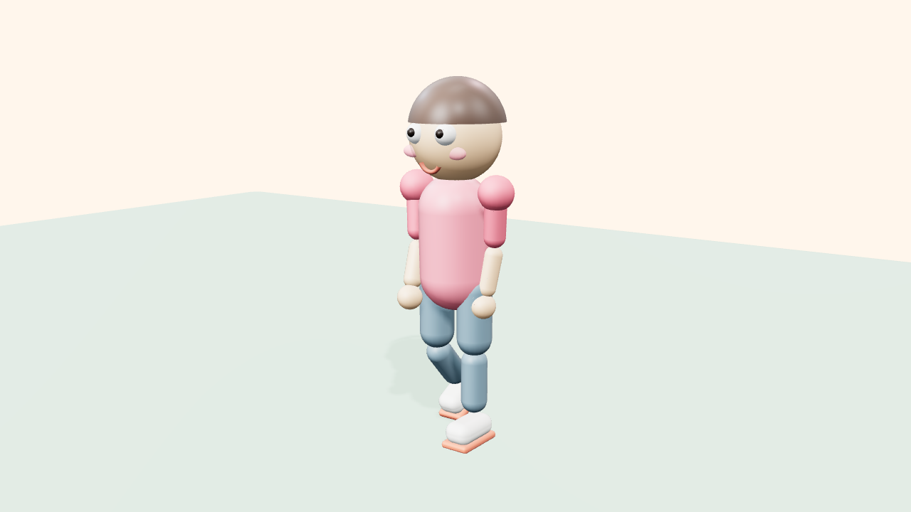

# Milo — Stylized Human Character

A fully-rigged, fully-animated procedural human — no model files, no external
assets, just code. Demonstrates the skill's character-building rules from both
production paths.



## What it demonstrates

| Rule | Where |
|---|---|
| Joint hierarchy with pivots **at the anatomical joint** | `buildHuman()` — hips → knees → ankles, torso → shoulders → elbows |
| ~3.9-head stylized proportions (cute, not chibi) | proportions table in the build header |
| Zero sharp edges (Puffy bible) | capsules, spheres, rounded boxes only |
| Walk cycle with knee bend, counter-rotation, hip bob | `animateHuman(rig, t, { mode: 'walk' })` |
| Idle life: breathing, weight shift, blinking | `mode: 'idle'` |
| Gesture with anticipation & overshoot | `mode: 'wave'` (easeOutBack raise, hand oscillation) |

## Run it

**Live demo (GitHub Pages):** `docs/demos/human/index.html` — orbit with the mouse,
switch modes (`walk / idle / wave`) in the HUD.

**Locally:**
```bash
git clone https://github.com/matinsizen/ai-3d-animator-skill.git
cd ai-3d-animator-skill
python3 -m http.server 8000
# open http://localhost:8000/docs/demos/human/
```

**Headless render (Path A):**
```bash
node examples/render-frames.mjs http://localhost:8000/docs/demos/human/index.html \
  --w 1920 --h 1080 --fps 30 --secs 8
bash examples/assemble-video.sh frames human-walk.mp4 --gif human.gif
```

**Blender (Path B):**
```bash
blender -b -P examples/human-character/blender-human.py -- --mode walk --secs 8 --fps 30 --render
# → ./human-walk_1280x720_30fps0001-0240.mp4
```

## Files

- `threejs-human.js` — Path A. ES module: `buildHuman()`, `animateHuman(rig, t, opts)`, `INFO`
- `blender-human.py` — Path B. Empty-joint rig + keyframes + CYCLES modifiers, renders MP4 headlessly

## Customization knobs

- Proportions: all sizes are named constants in the build header (head radius, hip height, limb lengths)
- Palette: the `C` object at the top — swap for any style bible's palette
- Animation: `cadence` (strides per loop), `hipSwing`, `kneeBend`, `armSwing` — everything is a pure function of time, so any change stays loop-safe
