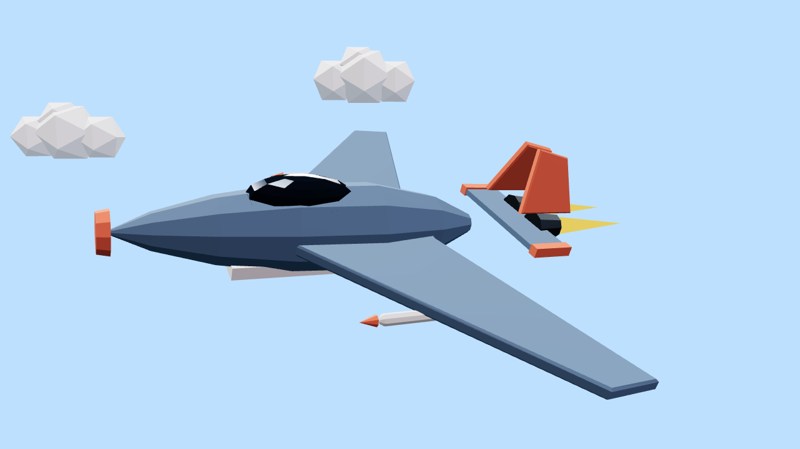

# Swift — Jet Fighter (Low-poly)

Hard-surface vehicle built entirely from code: lathe fuselage, extruded delta
wings, canted twin tails, glass canopy, animated afterburner cones, missiles —
in the **Low-poly Flat** style bible (flat shading, bold palette, crisp sun).



## What it demonstrates

| Rule | Where |
|---|---|
| Lathe/sweep fuselage from a profile curve | `LatheGeometry` with 8-point profile, 10 segments |
| Extruded lifting surfaces from 2D shapes | `ExtrudeGeometry` from wing/tail `Shape`s |
| Flat shading as a style choice | `flatShading: true` everywhere, low segment counts |
| Loop-safe flight path (one full circle per loop) | `animateJet()` — position & bank are pure functions of `t/T` |
| Banked turns, afterburner pulse, chase camera | `chaseCamera()` — deterministic, no jitter |
| The one legal linear motion | constant circular flight (turntable rule) |

## Run it

**Live demo:** [`docs/demos/jet/`](https://matinsizen.github.io/ai-3d-animator-skill/demos/jet/) — the camera follows the jet; orbit is disabled in chase mode.

**Blender (Path B):**
```bash
blender -b -P examples/jet-fighter/blender-jet.py -- --secs 8 --fps 30 --render
# bmesh-swept wings, TRACK_TO chase camera, emissive afterburners
```

## Customization knobs

- Wing shape: edit the `wingShape` / `tailShape` vertices — sweep, span, chord
- Palette: `C` — try the Neon bible (dark body + emissive strips) for an instant cyberpunk jet
- Flight: patrol radius `R`, bank angle `-0.42`, bob amplitude `0.45`
