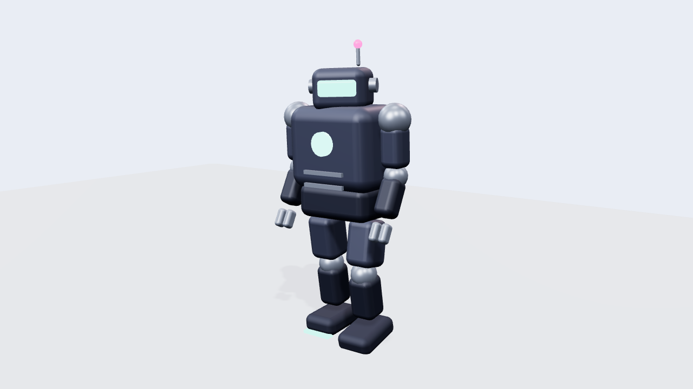

# Bolt — Toy Mech Robot

Friendly-machine hard-surface character: rounded boxes with honest panel-like
construction, emissive visor/core/toe accents (the Neon bible's one rule:
neon is emission, never diffuse), heavy **stomp walk with weight**.



## What it demonstrates

| Rule | Where |
|---|---|
| Rounded-box construction (`RoundedBoxGeometry`) | every shell part, bevel = "toy plastic" |
| Weight illusion: hips dip on plant, big flat feet, body sway | `animateRobot(rig, t, { mode: 'patrol' })` |
| Stiff-machine arm swing (elbows locked at ~90°) | constant elbow offset + reduced swing |
| Servo head scan | one eased yaw sweep per loop |
| Emissive accents that pulse | core + visor + antenna, loop-safe sine |

## Run it

**Live demo:** [`docs/demos/robot/`](https://matinsizen.github.io/ai-3d-animator-skill/demos/robot/) — modes `patrol / idle`.

**Blender (Path B):**
```bash
blender -b -P examples/robot-mech/blender-robot.py -- --mode patrol --secs 8 --fps 30 --render
```

## Customization knobs

- `C` palette — swap the shell for warm white + orange = consumer robot; black + red = war mech
- Stomp weight: hip dip `0.045`, sway `0.045`, torso counter `-0.11`
- Visor color: one hex — it is emissive, so it glows in any dark scene
