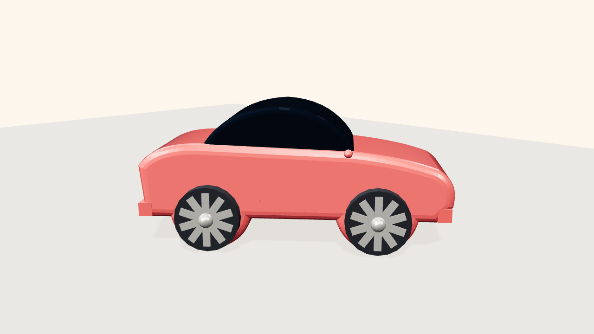

# Jelly — City Car

Vehicle body from a single **extruded side-profile with beveled edges** (the
pro trick: one operation gives rounded car sides), separate glass greenhouse,
spoked wheels that visibly spin, emissive lights. Clearcoat paint from the
product-render toolbox.



## What it demonstrates

| Rule | Where |
|---|---|
| Profile-extrude-bevel body pipeline | `bodyShape()` + `ExtrudeGeometry` with bevel |
| Wheel arches cut from the profile | `absarc()` arcs in the 2D shape — no booleans needed |
| Glass as a separate greenhouse form | `glassShape()`, wider than the roofline so sides read as windows |
| Visible wheel spin | 5 spokes + hub, `rotation.z` driven in `animateCar()` |
| Turntable = the one legal linear motion | `mode: 'showroom'` |
| Body bounce & roll on rough road | `mode: 'drive'` — layered sines |

## Run it

**Live demo:** [`docs/demos/car/`](https://matinsizen.github.io/ai-3d-animator-skill/demos/car/) — modes `showroom / drive`.

**Blender (Path B):**
```bash
blender -b -P examples/sports-car/blender-car.py -- --mode showroom --secs 8 --fps 30 --render
```

## Customization knobs

- Paint: `M.paint` color + `clearcoat` — one-line restyle
- Silhouette: the `verts`/`Shape` points control hood height, roofline, trunk
- Drive feel: bounce amplitude/frequencies in `animateCar()` (`mode: 'drive'`)
